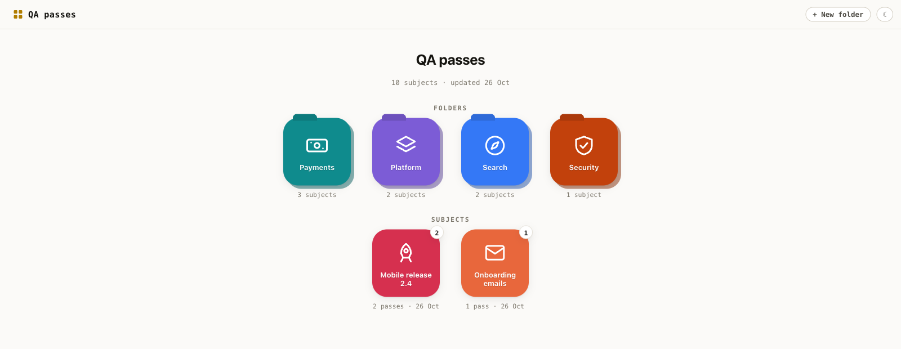
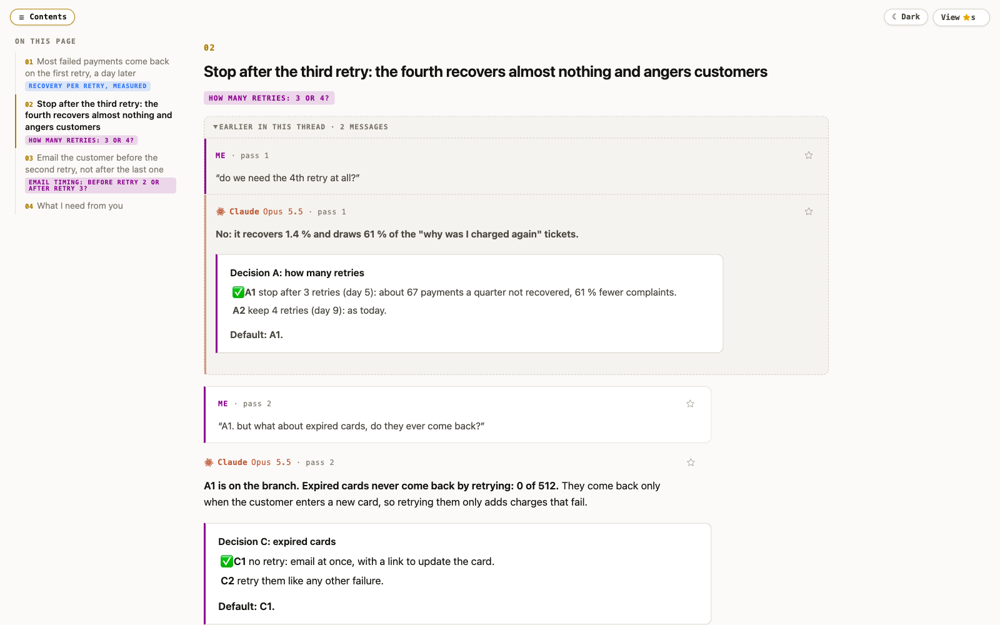
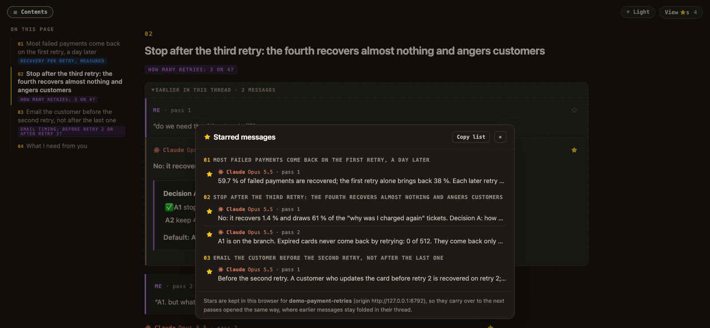
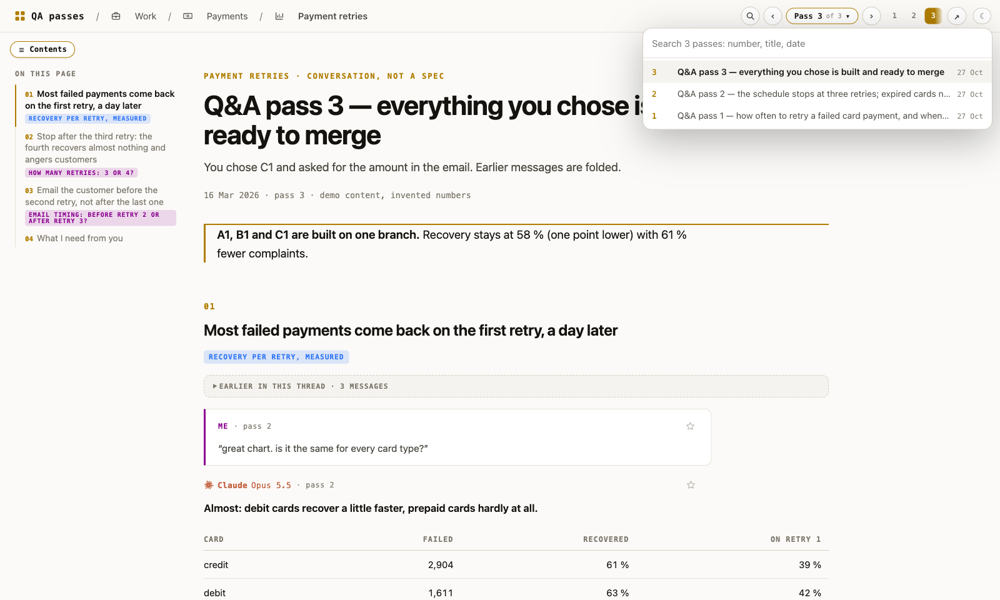

# QAP

Tooling for **QA passes**: the pages an AI agent writes, one per round of a design conversation, for a human to read
and answer.



## A QA pass

One self-contained HTML page that quotes you point by point, answers each point in its own thread (earlier rounds
folded), and ends with numbered decisions, each with a default.

<p>
  
  
</p>

Light and dark themes, a contents pane, stars that carry over to the next pass, links that open the folds they point
into, and a button back to where you clicked. CSS, JS and images are inlined: the page opens offline.

## `qap`, the CLI

```bash
qap new-subject payments/retries --title "Payment retries" --icon chart --qa-project retries
qap carry retries              # start the next pass: fold the last round, add the new round's placeholders
qap build retries --check      # build the page (links, labels, inlined images), then lint it
qap list                       # folders, subjects and their passes
qap serve --open               # the dashboard
```

Agents add `--json`: no prompts, JSON out. `skill/` is the `qa-pass` agent skill that tells an agent how to write a
pass and when to call `qap`.

## The dashboard

`qap serve` serves the dashboard and every pass from one local origin, so stars and the theme follow you from pass to
pass. Open a subject and its latest pass shows, with a pass selector made for 40+ passes.



## Store your passes in git

`qap` can keep the whole content root (projects, folders, subjects, passes, images) in a git repository you own,
as a backup and to sync between machines. It works like the [Obsidian Git](https://community.obsidian.md/plugins/obsidian-git)
plugin for a vault.

```bash
qap storage git init --remote git@github.com:you/qa-passes.git   # an empty private repo, or file:///path/to/backup.git
qap storage git status                                          # what is not backed up yet, a conflict, warnings
qap storage git sync                                            # commit, pull and push now
```

- **Automatic**: once set up, it commits, pulls and pushes after each `qap build`, when `qap serve` starts, and
  every 10 minutes while it runs. The dashboard's top bar shows `git ✓`, `git ● 3 changed` or `git ⚠ conflict`.
  The pill opens a Git backup view with Sync now and the latest commits.
- **Restore** on another machine: run the same `init` on an empty content root.
- **Never force-pushes.** If this machine and the remote changed the same file, the merge is undone, so no
  conflict markers end up in a pass. The files are listed and automatic syncs pause. You then choose with
  `qap storage git resolve --mine` or `--theirs` (the other version stays in the history), or you merge by hand.
- **Credentials stay with git**: your ssh agent or credential helper. `qap` never stores one. Background syncs
  have no terminal, so a passphrase prompt fails instead of hanging.
- **The content root gets its own repository**, even inside another repository. It never touches that other one.
- **Settings**: `qap plugins config git-storage` sets the interval, the commit message template (`{{date}}`,
  `{{hostname}}`, `{{fileCount}}`, `{{subjects}}`, `{{trigger}}`…), merge or rebase, push off, and commit signing.

## Plugins

The git backup is the first plugin. Plugins follow Obsidian's model: a folder with a `manifest.json`, a
`main.py` whose `onload()` registers commands, events (`pass_built`, `content_changed`, `startup`), routes,
intervals and a settings tab, and an optional `web/main.js` for the dashboard (status items, views, ⧉ menu
commands). Core plugins ship with `qap`. Community plugins go in `~/.config/qap/plugins` and stay off until you
turn them on.

```bash
qap plugins                                         # what is installed, on or off
qap plugins install examples/plugins/build-log      # the example plugin
qap plugins enable build-log && qap build-log show
```

How to write one: [docs/plugins.md](docs/plugins.md).

## Run it

```bash
uv run qap --help                      # or bin/qap: Python 3.10+, standard library only
python3 examples/make_demo.py /tmp/qap-demo && bin/qap serve --root /tmp/qap-demo --open
```

Passes live outside this repo, in a content root (`--root`, `QAP_CONTENT_ROOT` or `qap config content_root <path>`).
Everything else: [docs/reference.md](docs/reference.md).
